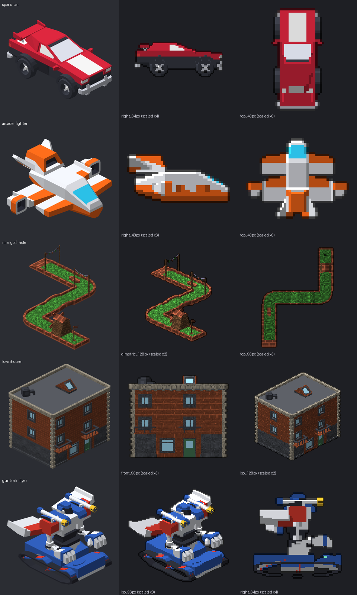

# Asset Forge Factory

A Claude Code workspace that mass-produces game assets out of Kenney's [Asset Forge](https://kenney.nl/tools/asset-forge) block library. You write a work order ("a red sports car, a 2-storey brick townhouse, side-view sprites at 64px"), Claude assembles the models from Asset Forge blocks with a Python toolchain, and you collect finished `.glb` models (Godot / three.js ready), Asset Forge `.model` files you can open and tweak in the app, and optional crisp pixel-art sprites rendered from any angle.



Asset Forge has no CLI, so `forge/` reimplements what's needed: it extracts the block meshes from the app's data, reads and writes `.model` files, exports GLB, and renders previews and sprites with its own software renderer. The app itself is only needed as the block source and as a 3D viewer/editor.

## What's in the repo

| path | what |
|---|---|
| `forge/` | Python toolchain: `forge.py` (core API, GLB export, renderer), library extraction, catalogue builder, texture sorter, collection import/rotate tools, work order parser, archiver. `examples/` has the five build scripts behind the image above. |
| `.claude/skills/asset-forge/` | The Claude Code skill: the build workflow, API, conventions and placement recipes. |
| `WorkOrders/` | `order-form.html` (fill in, save as markdown) and `TEMPLATE.md`. |
| `GUIDE.md` | Plain-language user manual: placing orders, surface modes, sprite options, engine facing, adding collections. |
| `Asset Forge 2.5.3 (Windows)/Collections/RC_Primitives/` | 167 extra primitives (Reactorcore's Deluxe Primitives, standardised for Asset Forge). |
| `Asset Forge 2.5.3 (Windows)/Textures/` | Two greyscale tint-texture packs: `32px Microart` (pixel-art look) and `128px SurfaceTex` (PS1/N64 look). |
| `Textures/` | Natural/built/abstract index of both packs, hand-reviewed overrides, and browsable contact sheets. |
| `sources/Deluxe Primitives/` | The raw primitives pack that `RC_Primitives` is generated from. |
| `docs/` | Showcase images and dev evidence (facing audit, primitives checks). |

**Not included:** Asset Forge itself. It's a commercial app that can't be redistributed, so you need your own copy.

## Setup

Windows, Python 3.13, and [Claude Code](https://claude.com/claude-code).

1. **Buy and download Asset Forge** (standard edition is enough) from [kenney.nl/tools/asset-forge](https://kenney.nl/tools/asset-forge). The workspace was built against version 2.5.3 for Windows.
2. **Extract it into this repo** so the app sits at `Asset Forge 2.5.3 (Windows)/Asset Forge.exe`. The folder already exists here holding the repo's own collection and texture packs, so let the extraction merge into it. If your version differs, rename your folder to `Asset Forge 2.5.3 (Windows)` (the toolchain looks for that name).
3. **Optional: add more collections.** Community block collections are shared on the [Asset Forge Collections and Blocks board](https://itch.io/board/98896/collections-and-blocks). Drop each one into `Asset Forge 2.5.3 (Windows)/Collections/`. The workspace was built with Kenney's car, city, nature, space base and urban house kits plus collections by Azeus, Keith, Quaternius and Zenith, but any set works. Check each collection's licence before shipping a game with it.
4. **Install the Python dependencies:**

   ```
   python -m venv .venv
   .venv\Scripts\pip install -r requirements.txt
   ```

5. **Build the local libraries** (generated, never committed). In order, these write the block meshes to `Library/`, the block index and contact sheets to `Catalogue/`, normalised texture copies to `Textures/normalized/`, and the sorted `M32 Natural`, `S128 Built`, ... texture folders into the app:

   ```
   .venv\Scripts\python forge/extract_library.py
   .venv\Scripts\python forge/catalogue.py
   .venv\Scripts\python forge/textures.py normalize
   .venv\Scripts\python forge/textures.py install
   ```

6. **Open the folder in Claude Code** and place a work order (see `GUIDE.md`). Before your first order, ask Claude to check whether any collections you added face −z. All collections here are standardised to face +z.

## Licences

- **Code** (`forge/`, the skill, the order form): MIT, see `LICENSE`.
- **Asset Forge blocks**: CC0 by Kenney. Models you build with them can be used commercially. The app itself must not be shared, so keep `Library/` (meshes extracted from it) private.
- **32px Microart, 128px SurfaceTex, Deluxe Primitives / RC_Primitives**: CC-BY 4.0 by Reactorcore. Credit "Reactorcore, [reactorcoregames.com](http://www.reactorcoregames.com)".
- **Third-party collections** carry their authors' licences.
